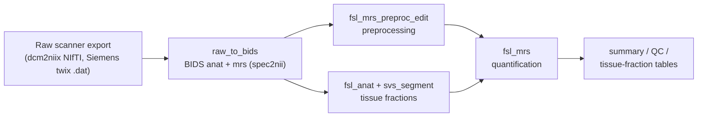

# Amblyopia Plasticity Study — MRS Analysis Pipeline

[](LICENSE)
[](https://www.python.org/)

Preprocessing and quantification pipeline for the magnetic resonance
spectroscopy (MRS) data of the study:

> Fars J. *et al.* **Dichoptic Training Boosts Binocular Vision and Reduces GABA
> in Adult Amblyopia** (in preparation).

It provides:
- A **raw-to-BIDS conversion** of the scanner export (anatomy and MRS)
- A **Python package (`mrs_pipeline`)** that runs MRS preprocessing,
  segmentation and quantification, and aggregates the results
- A **Jupyter notebook** that drives the full analysis
- **Voxel-overlap scripts** comparing voxel placement across sessions

For questions, contact Julien Fars — juju.fars@ndcn.ox.ac.uk.
For questions about FSL-MRS itself, see the
[FSL-MRS repository](https://github.com/wtclarke/fsl_mrs).

## Related repositories

This repository is one part of the study's code. The other parts are:

| Repository | Contents |
|---|---|
| [Amblyopia_plasticity_analysis](https://github.com/julienfars/Amblyopia_plasticity_analysis) | Statistical analysis and figures (behaviour, VR training, MRS results) |
| [visual_tests_amblyopia](https://github.com/julienfars/visual_tests_amblyopia) | Psychophysics test battery used to collect the behavioural data |
| [lazy_eye_VR_training](https://github.com/julienfars/lazy_eye_VR_training) | Unity app for the dichoptic VR training (Meta Quest 2) |

The summary tables produced here (GABA+/Glx concentrations, QC metrics, tissue
fractions) are the MRS inputs of `Amblyopia_plasticity_analysis`.

## Scientific background

Amblyopia ("lazy eye") is a visual disorder linked to disrupted binocular
processing, potentially mediated by GABAergic inhibition. This study
investigates whether **dichoptic visual training induces cortical
disinhibition**, measured as changes in **GABA+ and Glx** in:
- Primary visual cortex (V1), main hypothesis
- Sensorimotor cortex (M1), control region

## Data acquisition

### Anatomical MRI (T1)
- MPRAGE, 1 mm isotropic (files labelled `acq-MPRAGE_T1w`; T2w files are
  labelled `acq-TSE_T2w`)
- Used for registration, voxel placement and tissue segmentation

### MRS
- MEGA-PRESS, TE = 68 ms, TR = 1500 ms
- 160 ON / 160 OFF averages
- Voxels in V1 and M1

## Data availability

**No participant data is included in this repository.**

- **Raw MRS data:** requests for access can be addressed to Dr Betina Ip
  (betina.ip@ndcn.ox.ac.uk), subject to the study's ethics approval and a data
  sharing agreement.
- **Anatomical MRI data** will not be shared, to protect participant
  anonymity.

## Installation

### 1. Clone the repository
```bash
git clone https://github.com/julienfars/mrs_amblyopia_analysis.git
cd mrs_amblyopia_analysis
```

### 2. Install FSL
Install FSL separately, following the
[FSL installation guide](https://fsl.fmrib.ox.ac.uk/fsl/docs/install/).
Version used: **FSL 6.0**.

### 3. Create the conda environment
```bash
conda env create -f environment.yml
conda activate mrs_pipeline
```
This installs FSL-MRS at the version used for the study, together with
spec2nii (an FSL-MRS dependency) and the Python dependencies.

### 4. Install the Python package
```bash
pip install -e .
```

Check that the tools are available and the tests pass:
```bash
which fsl_anat svs_segment fsl_mrs fsl_mrs_preproc_edit spec2nii mrs_tools
pytest tests
```

## Pipeline



### 1. Raw data → BIDS

`mrs_pipeline.raw_to_bids` converts the raw export into a BIDS 1.10 dataset.
It is adapted from the conversion of the pRF_amblyopia repository, restricted
to anatomy and MRS. Expected raw layout, one folder per participant (session
folders optional):

```
<raw>/sub-10/[sub-10-ses-1-pretraining/]F3T_2022_021_019/   NIfTI + JSON (dcm2niix)
<raw>/sub-10/[sub-10-ses-1-pretraining/]2022_021_019/       MRS twix .dat files, voxel screenshots
```

```bash
mrs-raw-to-bids /path/to/raw --bids-dir /path/to/bids                  # dry run: prints the plan and warnings
mrs-raw-to-bids /path/to/raw --bids-dir /path/to/bids --apply          # convert
mrs-raw-to-bids /path/to/raw --bids-dir /path/to/bids --include sub-10 --apply
```

The conversion:
- **copies** the data and leaves the raw export untouched
- numbers sessions by scan ID, cross-checked against `pretraining` /
  `posttraining` labels in the folder names
- keeps the intensity-normalised (NORM) copy of the T1w/T2w
- converts each twix file with `spec2nii` (anonymised) to
  `sub-XX_ses-Y_acq-<label>_voi-<V1|M1>_<suffix>.nii.gz`:

  | Scan | File |
  |---|---|
  | MEGA-PRESS metabolites | `acq-megapress_..._svs` |
  | Phase-correction scans of the MEGA-PRESS file (eddy-current reference) | `acq-ecc_..._mrsref` |
  | Water reference (coil combination) | `acq-comb_..._mrsref` |
  | Water reference (quantification) | `acq-quant_..._mrsref` |
  | Linewidth check / flip-angle calibration | `acq-lw_..._mrsref`, `acq-facal_..._mrsref` |

- converts the last acquisition when a scan was repeated, and reports the
  repeat
- copies the raw twix files and screenshots to `sourcedata/`, and logs every
  file in `sourcedata/<sub>/conversion_log.tsv`

fMRI, field maps and eye-tracking data are left out: the pRF_amblyopia
repository converts those.

The Bash scripts that organised the data for the published results are kept,
unchanged, in [`scripts/legacy/`](scripts/legacy/).

### 2. MRS processing (Python)

The `mrs_pipeline` package reads the BIDS dataset and writes to
`<bids>/derivatives/mrs/`. It runs:
- Visual QC (`mrs_tools`)
- Preprocessing (`fsl_mrs_preproc_edit`)
- Segmentation (`fsl_anat`, `svs_segment`)
- Quantification (`fsl_mrs`)
- Aggregation of the summary, QC and tissue-fraction outputs

```python
import mrs_pipeline as mp

bids_dir = "/path/to/bids"
basis_sets = "/path/to/basis_sets"

mp.convert_raw_to_bids("/path/to/raw", bids_dir, apply=True)
mp.preproc(bids_dir)
mp.MRS_anat_process(bids_dir)
mp.svs_segment_process(bids_dir)
mp.mrs_analysis_process(bids_dir, basis_sets)
```

Subject filters (`include=["sub-10"]`, `exclude=[...]`) take exact
participant names.

**Basis sets:** we used
[`uzay_svs_mpress_68_with_db`](https://git.fmrib.ox.ac.uk/wclarke/win-mrs-basis-sets/-/tree/master/basis_sets/uzay_svs_mpress/uzay_svs_mpress_68_with_db?ref_type=heads)
from the [WIN MRS basis sets](https://git.fmrib.ox.ac.uk/wclarke/win-mrs-basis-sets).

### Processing settings used in the study

All steps use the tools installed with FSL-MRS (version in
`environment.yml`).

**Preprocessing** (`fsl_mrs_preproc_edit`), per voxel:
- coil combination (when the data are not already combined)
- frequency/phase alignment across dynamics within 1.9–4.2 ppm, using
  windows of 16 transients (`--align_window_dynamic 16`)
- eddy-current correction with a separate reference (`--ecc`)
- HLSVD residual water removal (`--hlsvd`)
- alignment of the edit-ON/OFF conditions within 2.5–3.5 ppm
  (`--align_ppm_edit 2.5 3.5`)
- separate water reference for quantification (`--quant`)

**Fitting** (`fsl_mrs`, truncated Newton algorithm), with a complex
polynomial baseline of order 0 (`--baseline_order -1`), NAA as the internal
reference and tissue-corrected water scaling (`--tissue` from
`svs_segment`):

| Spectrum | Basis set | Macromolecules | Combined metabolites |
|---|---|---|---|
| Difference (`diff`) | `diff` | `sysMM` | GABA+sysMM (GABA+), Glu+Gln+GSH (Glx), NAA+NAAG |
| Edit-ON (`edit_1`) | `on` | `sysMM` | as above, plus Cr+PCr |
| Edit-OFF (`edit_0`) | `off_updated` | MM09, MM12, MM14, MM17, MM21 | as above, with GABA combined with all MM |

Each FSL-MRS tool writes the exact options it ran with to `options.txt` in
its output folder.

**FSL-MRS version:** the results in the paper were produced with FSL-MRS
2.1.19, as pinned in `environment.yml`. We reran the full pipeline with
FSL-MRS 2.4 using the same commands and obtained consistent results. In
FSL-MRS 2.4, `--baseline_order` is superseded by `--baseline`, so that rerun
used the new default baseline (2nd-order polynomial) instead of order 0. Use
the pinned version to reproduce the published values exactly.

### 3. Notebook

[`notebook/fsl_mrs_notebook.ipynb`](notebook/fsl_mrs_notebook.ipynb) walks
through each step, from conversion to the final summary tables. Set `RAW_DIR`,
`DATA_DIR` (the BIDS dataset) and `BASIS_SETS_DIR` in its configuration cell.

### Extra: voxel overlap

These scripts compare voxel placement across sessions, compute overlap
metrics, and project voxels into MNI space:

```bash
scripts/voxel_overlap.sh --data /path/to/bids
scripts/combine_voxels.sh --data /path/to/bids
```

## Reproducibility notes

- No paths are hardcoded: set them through script arguments or notebook
  variables.
- Intermediate outputs are written to `derivatives/`; the BIDS raw folders are
  never modified.
- The published results used data organised by the legacy Bash scripts
  (`scripts/legacy/`). The new conversion uses the same spec2nii extraction
  and the same processing commands. It differs in two ways: the NIfTI-MRS
  headers are anonymised, and the NORM copy of the T1w is selected
  explicitly.
- Each step can be run on its own.
- FSL-MRS writes the exact options of each run to `options.txt` in its
  output folder.

## Citation

If you use this code, please cite it. The metadata is in
[`CITATION.cff`](CITATION.cff), and GitHub's **"Cite this repository"** button
generates APA/BibTeX from it.

## License

This code is released under the [MIT License](LICENSE).

FSL and FSL-MRS are not included in this repository. They are installed
separately and are distributed under their own licences (non-commercial use).
